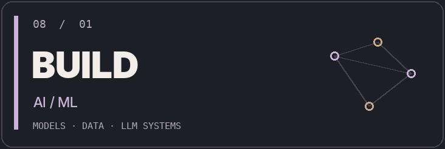
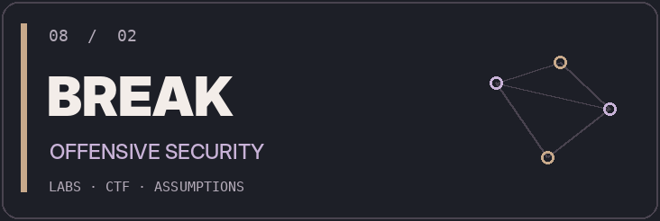
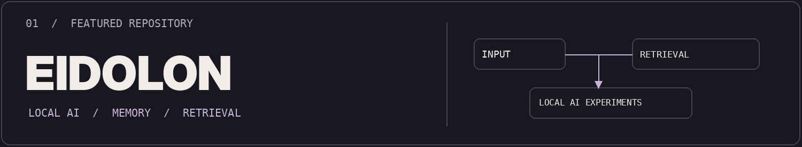

<!--
DEDESSORU / 08 — a personal technical field notebook.
Design, copy and image assets are original to this profile (the 8-ball mark was supplied by its owner).
Easter egg: the interesting part is never the polished result. It's the failed assumptions.
-->

<p align="center">
  <picture>
    <source media="(prefers-color-scheme: dark)" srcset="./assets/hero-dark.png">
    <source media="(prefers-color-scheme: light)" srcset="./assets/hero-light.png">
    
  </picture>
</p>

<p align="center">
  <b>Applied Mathematics · Igor Sikorsky Kyiv Polytechnic Institute</b><br>
  <sub>Building in AI/ML. Exploring offensive security. Moving toward AI Red Team research.</sub>
</p>

<p align="center">
  <a href="#the-intersection">THE IDEA</a> &nbsp; / &nbsp;
  <a href="#selected-work">PROJECTS</a> &nbsp; / &nbsp;
  <a href="#toolkit">TOOLKIT</a> &nbsp; / &nbsp;
  <a href="https://www.linkedin.com/in/dedessoru/">LINKEDIN</a>
</p>

<p align="center">
  <picture>
    <source media="(prefers-color-scheme: dark)" srcset="./assets/signal-dark.gif">
    <source media="(prefers-color-scheme: light)" srcset="./assets/signal-light.gif">
    
  </picture>
</p>

<a id="the-intersection"></a>
## `00 // THE INTERSECTION`

I'm **Oleksandr**, an Applied Mathematics student based in Kyiv. I explore two disciplines that inform each other: **building intelligent systems** and **testing how systems behave when assumptions fail**.

My hands-on work spans **ML models, recommendation systems, LLM applications, CTFs and authorized penetration-testing labs**. The intersection I'm working toward is **AI red teaming**.

<sub>Not two unrelated careers. One way of thinking: hypothesize → implement → test → inspect → iterate.</sub>

## `01 // TWO MODES`

<table>
<tr><td width="50%" valign="top">
<picture><source media="(prefers-color-scheme: dark)" srcset="./assets/build-dark.png"><source media="(prefers-color-scheme: light)" srcset="./assets/build-light.png"></picture>
<b>What I build</b><br>
Models for applied problems; RAG and LLM integrations; data-centric experimentation.
</td><td width="50%" valign="top">
<picture><source media="(prefers-color-scheme: dark)" srcset="./assets/break-dark.png"><source media="(prefers-color-scheme: light)" srcset="./assets/break-light.png"></picture>
<b>What I test</b><br>
Networks and services in authorized labs; exploit paths, CTF challenges and offensive tools.
</td></tr>
</table>

<a id="selected-work"></a>
## `02 // SELECTED WORK`

<a href="https://github.com/dedessoru/eidolon">
  <picture>
    <source media="(prefers-color-scheme: dark)" srcset="./assets/project-dark.png">
    <source media="(prefers-color-scheme: light)" srcset="./assets/project-light.png">
    
  </picture>
</a>

**[Eidolon](https://github.com/dedessoru/eidolon)** — an experimental AI assistant project exploring local models, retrieval and memory-oriented workflows. [Explore the repository →](https://github.com/dedessoru/eidolon)

<table>
<tr>
<td width="50%" valign="top">
<b>02 / Applied ML</b><br><br>
Hackathon projects involving <b>fraud detection</b>, <b>recommendation systems</b> and <b>computer vision</b>.<br><br>
<sub>PROJECT WORK · SOURCE MAY BE PRIVATE</sub>
</td>
<td width="50%" valign="top">
<b>03 / Security labs & CTFs</b><br><br>
Practical work on <b>Hack The Box</b> and <b>TryHackMe</b>, plus participation in a competition focused on critical-infrastructure security.<br><br>
<sub>AUTHORIZED TRAINING · NOT COMMERCIAL ENGAGEMENTS</sub>
</td>
</tr>
</table>

## `03 // EVIDENCE, NOT HYPE`

| Signal | What it means |
| :-- | :-- |
| **3rd place — KNU Open Mathematics Olympiad** | Mathematical problem-solving in a competitive setting. |
| **Critical Infrastructure Protection CTF · 2025** | Team-based cybersecurity competition participation. |
| **AI/ML hackathons** | Hands-on work with data, models and prototyping under time constraints. |
| **HTB / TryHackMe** | Independent practice in networking, enumeration and exploitation labs. |

<a id="toolkit"></a>
## `04 // TOOLKIT`

| Discipline | Technologies used |
| :-- | :-- |
| **Programming & systems** | `Python` · `Linux` · `Git` · `Docker` · `FastAPI` |
| **Machine learning** | `PyTorch` · `scikit-learn` · `Pandas` · `NumPy` · `Two-Tower Models` |
| **LLM applications** | `RAG` · `Function Calling` · `Reranking` · `ChromaDB` · `LLM APIs` |
| **Offensive security** | `Nmap` · `Gobuster` · `Metasploit` · `Burp Suite` |
| **C2 tools (labs)** | `Havoc` · `AdaptixC2` |
| **Protocols** | `TCP/IP` · `HTTP` · `DNS` · `SSH` · `SMB` · `FTP` · `SMTP` · `IMAP` |

## `05 // OPEN THE LAB NOTEBOOK`

<details>
<summary><b>01 — What does AI Red Team mean to me?</b></summary>
<br>
I want to study security at the boundary between <b>models, prompts, retrieval, tools and the systems around them</b> — not just make models, and not just run exploits. This is a direction of study, not a claim of professional AI safety research experience.
</details>

<details>
<summary><b>02 — What have I done in offensive security?</b></summary>
<br>
I work through authorized training environments and CTFs. Tools I have used include <b>Nmap, Gobuster, Metasploit, Burp Suite, Havoc and AdaptixC2</b>. My current emphasis is understanding each step and interpreting evidence, not collecting tool names.
</details>

<details>
<summary><b>03 — What counts as a good experiment?</b></summary>
<br>
A useful experiment should make the hypothesis explicit, record what changed, measure the outcome and preserve enough context to repeat the work. I try to apply this mindset to both ML and security practice.
</details>

<details>
<summary><b>04 — A small terminal easter egg</b></summary>

```bash
$ whoami
applied_math + machine_learning + offensive_security

$ cat /etc/motd
BUILD. BREAK. UNDERSTAND.

$ echo $NEXT_STEP
keep learning; publish the evidence
```

</details>

---

<p align="center"><sub>08 / END OF FIELD NOTES</sub></p>
<p align="center">
  <picture>
    <source media="(prefers-color-scheme: dark)" srcset="./assets/signature-dark.png">
    <source media="(prefers-color-scheme: light)" srcset="./assets/signature-light.png">
    
  </picture>
</p>
<p align="center">
  <sub><a href="https://github.com/dedessoru?tab=repositories">Repositories</a> &nbsp;·&nbsp; <a href="https://www.linkedin.com/in/dedessoru/">LinkedIn</a> &nbsp;·&nbsp; Kyiv, Ukraine</sub>
</p>
