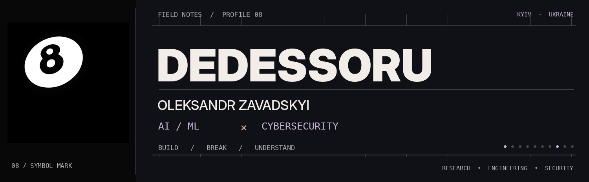
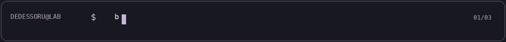

<!-- Profile README for dedessoru -->

<p align="center">
  <picture>
    <source media="(prefers-color-scheme: dark)" srcset="./assets/hero-dark.png">
    <source media="(prefers-color-scheme: light)" srcset="./assets/hero-light.png">
    
  </picture>
</p>

<p align="center">
  <a href="https://github.com/dedessoru?tab=repositories"></a>
  <a href="https://www.linkedin.com/in/dedessoru/"></a>
  
</p>

<p align="center">
  <b>Applied Mathematics @ Igor Sikorsky Kyiv Polytechnic Institute</b><br>
  <sub>Building intelligent systems · studying how systems fail · moving toward AI red teaming</sub>
</p>

<p align="center">
  <picture>
    <source media="(prefers-color-scheme: dark)" srcset="./assets/signal-dark.gif">
    <source media="(prefers-color-scheme: light)" srcset="./assets/signal-light.gif">
    
  </picture>
</p>

## `00 // THE SHORT VERSION`

I'm **Leks** — an Applied Mathematics student working at the intersection of **AI/ML and cybersecurity**.

I like taking an idea from hypothesis to working system, then stress-testing the assumptions underneath it. Right now that means building ML and LLM applications, practicing in authorized security labs, and learning how to evaluate AI systems more adversarially.

> **Build. Break. Understand.**

## `01 // WHAT I'M EXPLORING`

<table>
<tr>
<td width="50%" valign="top">

### Build systems

- Local-first AI assistants
- Retrieval-augmented generation
- Recommendation and ranking systems
- Applied ML and computer vision
- Small tools that turn experiments into usable software

</td>
<td width="50%" valign="top">

### Test systems

- CTFs and authorized training labs
- Network and service enumeration
- Web application security fundamentals
- Threat modeling for AI applications
- Failure modes across models, prompts, tools and data

</td>
</tr>
</table>

## `02 // SELECTED WORK`

<table>
<tr>
<td width="50%" valign="top">

### [Eidolon](https://github.com/dedessoru/eidolon)

A local AI companion exploring **memory, retrieval, personas and tool use** with Python, Ollama, ChromaDB and Flet.

`Python` `RAG` `Ollama` `ChromaDB`

</td>
<td width="50%" valign="top">

### [Anix](https://github.com/dedessoru/anix)

A Rust project and a place to experiment with systems programming, architecture and implementation details close to the metal.

`Rust`

</td>
</tr>
<tr>
<td width="50%" valign="top">

### [Fatda Labs](https://github.com/dedessoru/fatda_labs)

Notebook-based experimentation across data, models and applied machine learning.

`Jupyter` `ML`

</td>
<td width="50%" valign="top">

### [Markov Melody](https://github.com/dedessoru/markovmelody)

A generative music experiment using Markov chains — simple probabilistic ideas, audible output.

`Markov chains` `Generative systems`

</td>
</tr>
</table>

[See all repositories →](https://github.com/dedessoru?tab=repositories)

## `03 // TOOLKIT`

<p>
  
</p>

| Area | Tools and concepts |
| :-- | :-- |
| **AI / ML** | PyTorch · scikit-learn · Pandas · NumPy · computer vision · recommendation systems |
| **LLM applications** | RAG · vector search · reranking · function calling · local models · Ollama |
| **Security labs** | Nmap · Gobuster · Metasploit · Burp Suite · Hack The Box · TryHackMe |
| **Systems** | Linux · Docker · FastAPI · TCP/IP · HTTP · DNS · SSH · SMB |

## `04 // CURRENT DIRECTION`

I'm building toward **AI red team research**: understanding where models, prompts, retrieval pipelines, tools and surrounding infrastructure become unreliable or exploitable — and turning those observations into reproducible experiments.

My working loop is deliberately simple:

```text
hypothesize  →  implement  →  test  →  inspect  →  iterate
```

<details>
<summary><b>What I value in a project</b></summary>
<br>
Clear assumptions, measurable outcomes, useful failure cases, and enough documentation for someone else to reproduce the result.
</details>

<details>
<summary><b>What I'm learning next</b></summary>
<br>
More rigorous ML evaluation, secure AI application design, adversarial testing, and the engineering practices needed to move experiments into dependable systems.
</details>

## `05 // FIND ME`

<p align="center">
  <a href="https://github.com/dedessoru">GitHub</a> &nbsp;·&nbsp;
  <a href="https://www.linkedin.com/in/dedessoru/">LinkedIn</a> &nbsp;·&nbsp;
</p>

<p align="center">
  <picture>
    <source media="(prefers-color-scheme: dark)" srcset="./assets/signature-dark.png">
    <source media="(prefers-color-scheme: light)" srcset="./assets/signature-light.png">
    
  </picture><br>
  <sub>08 / keep learning; publish the evidence</sub>
</p>
